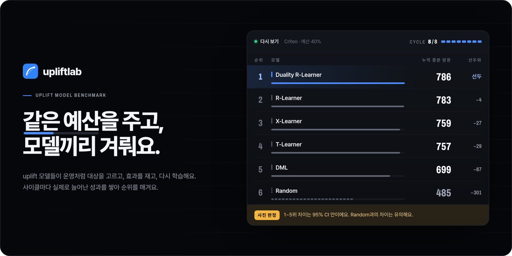
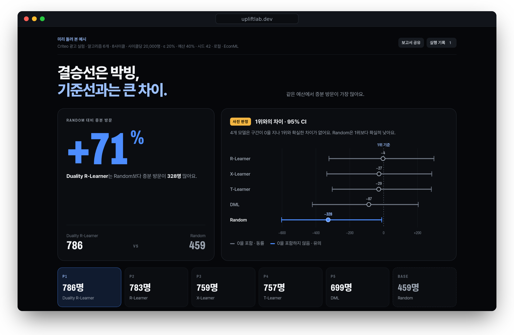

<a href="https://upliftlab.dev"></a>

<div align="center">

**Find the uplift model that buys the most incremental outcome for the same budget, before it goes live.**

[](https://upliftlab.dev)
[](https://pypi.org/project/upliftlab/)
[](https://github.com/Funbucket/upliftlab/actions/workflows/test.yml)
[](https://github.com/py-why/EconML)
[](https://github.com/Funbucket/upliftlab/blob/main/pyproject.toml)
[](https://github.com/Funbucket/upliftlab/blob/main/LICENSE)

**[Run it in the browser →](https://upliftlab.dev)** &nbsp;·&nbsp; [Install](#quick-start) &nbsp;·&nbsp; [한국어](https://github.com/Funbucket/upliftlab/blob/main/README.md)

<sub>The standings above are a real run: the Criteo ad experiment (199,837 users), a 40% budget, 8 cycles, EconML models. The site replays it cycle by cycle.</sub>

</div>

> [!NOTE]
> The interface follows your browser language (Korean or English); switch with **KO / EN** in the header or open [upliftlab.dev/?lang=en](https://upliftlab.dev/?lang=en). The longer guides in `docs/` are in Korean for now.

## Why

An offline metric such as Qini scores one ranking on one holdout. In production a model picks who to treat, the effect is measured, the model retrains on what it saw, and the budget runs out at some point. upliftlab runs that loop for every model on the same users and tells you which one bought the most incremental outcome, and whether the gap is real.

In a synthetic coupon market where cost differs by user, the Qini winner bought on average 17% less incremental outcome than the loop winner for the same budget, in all 10 seeds; AUCC, which accounts for cost, picked the loop winner every time. On Criteo the winner changed from seed to seed, and the only clear gap was to Random. [The experiment and how to rerun it](https://github.com/Funbucket/upliftlab/blob/main/docs/offline-vs-loop.md) (Korean).

- **The production loop, cycle by cycle.** Each model selects its targets under the budget, the targets are split into treatment and control to measure the effect, and every model retrains before the next cycle.
- **Same conditions for every model.** Same users, same budget, same random Explore group. The only difference between models is who they chose.
- **Honest about ties.** The gap to the leader comes with a 95% CI. When ranks can't be told apart, the result says it is a photo finish.
- **Your data stays with you.** The web version runs in your browser (Pyodide), the local version in your Python. Shared reports hold aggregates only.

## Quick start

**In the browser, nothing to install.** Open [upliftlab.dev](https://upliftlab.dev/?lang=en) and press **Start**. The Criteo data, six built-in models and a 40% budget are preselected.

**Locally, with EconML.** The same screen, served from your own Python. Use large files, the libraries you already have, and your GPU.

```bash
pip install upliftlab
upliftlab                # opens http://127.0.0.1:4180
```

With uv, `uvx upliftlab` runs it without installing. The first run downloads the Criteo sample (2.3 MB) once.

**Without the screen.** Compare models on your own CSV and get the standings in the terminal:

```bash
upliftlab run --data my_experiment.csv --algorithm my_model.py
```

> [!NOTE]
> EconML can't run in the browser, so the web version runs the same methods written with scikit-learn only. The result screen and the report say which one ran. Intel Macs and ARM Linux/Windows get the scikit-learn versions too, since EconML ships no wheels there.

## Reading the result

<a href="https://upliftlab.dev"></a>

- **The headline is the conclusion.** If the runner-up is within the 95% CI of the leader it reads `결승선은 박빙` (photo finish), and it says whether the gap to the baseline (Random) is real.
- **Over Random**: how much more incremental outcome the leader bought than random targeting with the same budget.
- **Gap to the leader, 95% CI**: grey when the interval crosses zero, blue when the model is clearly behind.
- Below: the ranking table, what the leader's targets look like, per-cycle metrics, a row-level log, and the Cost and Qini curves. Offline AUCC, Qini (with a 95% CI) and uplift@k score each served model on that cycle's Explore group, a random holdout it never trained on.

## Built-in models

| Model | EconML | What it does |
| :-- | :-- | :-- |
| T-Learner | `metalearners.TLearner` | Difference between treatment and control outcome models |
| X-Learner | `metalearners.XLearner` | Imputed effects weighted by the propensity |
| R-Learner | `dml.NonParamDML` | Non-parametric CATE from residuals |
| DML | `dml.LinearDML` | Linear CATE from residuals |
| Duality R-Learner | `dml.NonParamDML` × 2 | CATE of outcome and of cost together, with λ picked on validation |
| Random | NumPy | The baseline |

Each one is a single `class Model` file you can open and edit on the screen.

## Bring your own model

One Python file that doesn't import upliftlab. Use scikit-learn, LightGBM or PyTorch as usual.

```python
class Model:
    def fit(self, train, validation, context):  # train.X, train.t, train.y, train.cost
        ...
    def predict(self, X):                        # one score per user; higher scores are targeted first
        ...
```

<details>
<summary><b>Data format</b> · a randomized experiment log with at least 1,000 rows</summary>
<br>

Column names are free; the screen guesses the roles and you can change them.

| Role | Example | Values |
| :-- | :-- | :-- |
| Treatment | `treatment` | 0 = control, 1 = treated. Several treatments: 1, 2, 3… |
| Outcome | `retained` | What you want more of: conversion, purchase, retention |
| Cost (optional) | `coupon_cost` | What the treatment cost. Without it every treatment costs 1 |
| Covariates | `visit_freq`, … | User features measured **before** treatment |

The default data is the [Criteo](https://ailab.criteo.com/criteo-uplift-prediction-dataset/) uplift dataset: a 100k treated + 100k control sample (199,837 users, outcome = site visit) of the original 13.98M.

</details>

<sub>[MIT](https://github.com/Funbucket/upliftlab/blob/main/LICENSE). The Criteo sample is [CC BY-NC-SA 4.0](https://github.com/Funbucket/upliftlab/blob/main/web/data/LICENSE-criteo.md), non-commercial use only; it is not inside the pip package and is downloaded from this repository on first use. Fonts: Pretendard, Archivo and Geist Mono under the SIL Open Font License (`web/fonts/LICENSE`); editor bundle: `web/vendor/LICENSES.txt`.</sub>
