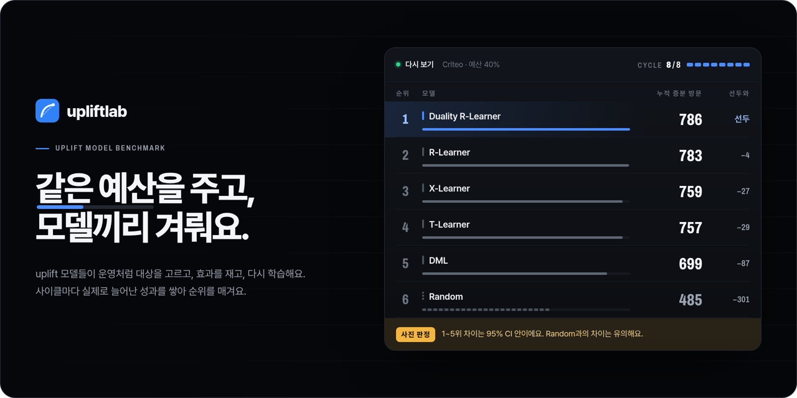
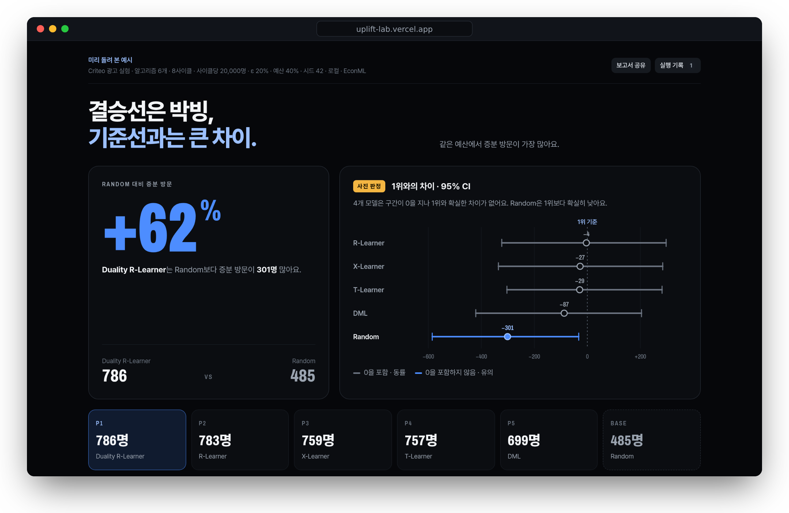

<a href="https://uplift-lab.vercel.app"></a>

<div align="center">

**같은 예산에서 증분 성과를 가장 많이 내는 uplift 모델을, 운영 전에 찾아요.**

[](https://uplift-lab.vercel.app)
[](https://pypi.org/project/upliftlab/)
[](https://github.com/py-why/EconML)
[](https://github.com/Funbucket/upliftlab/blob/main/pyproject.toml)
[](https://github.com/Funbucket/upliftlab/blob/main/LICENSE)

**[웹에서 바로 실행 →](https://uplift-lab.vercel.app)** &nbsp;·&nbsp; [로컬 설치](#빠른-시작) &nbsp;·&nbsp; [사용 안내](https://github.com/Funbucket/upliftlab/blob/main/docs/guide.md)

<sub>위 순위표는 Criteo 광고 실험 199,837명을 예산 40%, 8사이클로 돌린 실제 결과예요(EconML). 사이트에서는 사이클 1부터 8까지 다시 보여 줘요.</sub>

</div>

## 왜 upliftlab인가요

Qini가 가장 높은 모델이 운영에서도 가장 많이 남길까요? 오프라인 지표 하나로 모델을 고르면, 대상 선정과 재학습을 반복하면서 생기는 차이를 놓쳐요.

- **운영 루프를 그대로 돌려요.** 모델마다 대상을 고르고, 처치군과 대조군으로 효과를 재고, 재학습하는 과정을 사이클마다 반복해요.
- **같은 조건에서만 비교해요.** 모든 모델이 같은 사용자, 같은 예산, 같은 무작위 Explore 그룹을 써요. 차이는 대상을 고른 방식에서만 생겨요.
- **차이가 유의한지 보여 줘요.** 1위와의 차이를 95% CI로 그려서, 순위를 확정할 수 없는 박빙이면 그렇다고 적어요.
- **데이터는 밖으로 나가지 않아요.** 웹은 브라우저 안에서, 로컬은 내 Python에서 돌아요. 공유 보고서에는 집계 값만 들어가요.

## 빠른 시작

**웹 · 설치 없이.** [uplift-lab.vercel.app](https://uplift-lab.vercel.app)을 열고 `비교 시작`을 눌러요. Criteo 데이터, 기본 모델 6개, 예산 40%가 이미 골라져 있어요.

**로컬 · EconML로.** 같은 화면이 내 Python에서 돌아가요. 큰 데이터, 이미 설치한 라이브러리, GPU를 그대로 써요.

```bash
pip install upliftlab
upliftlab                # http://127.0.0.1:4180 이 열려요
```

uv를 쓴다면 설치 없이 `uvx upliftlab` 한 줄이면 돼요. 처음 실행할 때 Criteo 표본(2.3MB)을 한 번 내려받아 두고, 그다음부터는 그대로 써요.

> [!NOTE]
> 브라우저에서는 EconML을 쓸 수 없어서, 웹은 같은 방법을 scikit-learn으로 쓴 경량판으로 돌려요. 결과 화면과 보고서에 어느 쪽으로 돌렸는지 표시해요.

## 결과 읽는 법

<a href="https://uplift-lab.vercel.app"></a>

- **제목**이 결론이에요. 2위와의 차이가 95% CI 안이면 `결승선은 박빙`이라고 쓰고, 기준선(Random)과의 차이가 확실한지도 함께 적어요.
- **Random 대비**는 1위가 무작위로 고를 때보다 같은 예산으로 성과를 얼마나 더 냈는지예요.
- **1위와의 차이 · 95% CI**에서 구간이 0을 지나는 모델은 회색, 확실히 낮은 모델은 파란색이에요. 박빙이면 `사진 판정` 표시가 붙어요.
- 그 아래에 순위표, 1위가 고른 사용자의 특성, 사이클별 지표, Row-level 로그, Cost Curve가 이어져요.

## 데이터에서 보고서까지

| ① 데이터 넣기 | ② 비교 시작 | ③ 보고서 공유 |
| :-- | :-- | :-- |
| 실험 로그 CSV를 끌어다 놓으면 처치, 결과, 비용, 공변량 열을 알아서 골라요. | 모델, 선정 방식, 예산을 확인하고 `비교 시작`을 눌러요. 끝나면 결과로 바로 내려가요. | 1위 모델, Random 대비 증분 성과, 2위와의 차이를 HTML 보고서, PDF, 메신저 요약으로 보내요. |

## 기본 모델

| 모델 | EconML 구현 | 하는 일 |
| :-- | :-- | :-- |
| T-Learner | `metalearners.TLearner` | 처치군과 대조군 모델의 예측 차이 |
| X-Learner | `metalearners.XLearner` | 대체한 효과를 propensity로 가중 |
| R-Learner | `dml.NonParamDML` | 잔차로 푸는 비모수 CATE |
| DML | `dml.LinearDML` | 잔차로 푸는 선형 CATE |
| Duality R-Learner | `dml.NonParamDML` × 2 | 성과와 비용의 CATE를 함께 보고 λ를 validation에서 골라요 |
| Random | NumPy | 비교 기준선 |

각 파일은 `class Model` 하나라서 화면에서 바로 열어 보고 고쳐 쓸 수 있어요.

## 내 알고리즘 추가

upliftlab을 import하지 않는 Python 파일 하나예요. scikit-learn, LightGBM, PyTorch를 평소처럼 써요.

```python
class Model:
    def fit(self, train, validation, context):  # train.X, train.t, train.y, train.cost
        ...
    def predict(self, X):                        # 사용자마다 점수 하나. 높은 순서로 대상을 골라요
        ...
```

웹에서는 `알고리즘` 화면의 `알고리즘 추가`에서 시작 틀을 골라 편집해요. 로컬에서는 화면 없이도 비교할 수 있어요.

```bash
upliftlab run --data my_experiment.csv --algorithm my_model.py
```

<details>
<summary><b>내 데이터 형식</b> · 처치를 무작위로 배정한 실험 로그, 1,000행 이상</summary>
<br>

열 이름은 자유예요. 형식이 헷갈리면 화면의 `예시 파일 내려받기`로 받은 파일을 참고하세요.

| 역할 | 예시 열 | 값 |
| :-- | :-- | :-- |
| 처치 | `treatment` | 0 = 대조군, 1 = 처치. 여러 종류면 1, 2, 3… |
| 결과 | `retained` | 전환, 구매, 리텐션처럼 늘리고 싶은 값 |
| 비용 (선택) | `coupon_cost` | 처치로 쓴 비용. 없으면 처치 1건당 1로 계산해요 |
| 공변량 | `visit_freq`, … | 처치 **전에** 측정한 사용자 특성 |

기본 데이터는 [Criteo](https://ailab.criteo.com/criteo-uplift-prediction-dataset/) 광고 실험이에요. 원본 1,398만 명에서 처치군과 대조군을 10만 명씩 뽑은 표본(199,837명, 결과는 사이트 방문)이 사이트와 패키지에 들어 있어요.

</details>

## 더 보기

[사용 안내](https://github.com/Funbucket/upliftlab/blob/main/docs/guide.md) · 선정 방식 5가지, 명령줄 옵션, 결과 읽는 법<br>
[알고리즘 계약](https://github.com/Funbucket/upliftlab/blob/main/engine/README.md) · `fit`과 `predict`에 들어오는 값, 코드 검사 규칙<br>
[개발 참여](https://github.com/Funbucket/upliftlab/blob/main/CONTRIBUTING.md) · 빌드, 테스트, 폴더 구조<br>
[변경 기록](https://github.com/Funbucket/upliftlab/blob/main/CHANGELOG.md)

<sub>[MIT](https://github.com/Funbucket/upliftlab/blob/main/LICENSE). Criteo 표본은 [CC BY-NC-SA 4.0](https://github.com/Funbucket/upliftlab/blob/main/web/data/LICENSE-criteo.md)이라 비상업적으로만 쓸 수 있어요. pip 패키지에는 넣지 않고 처음 쓸 때 이 저장소에서 내려받아요. Pretendard, Archivo, Geist Mono 글꼴은 SIL Open Font License(`web/fonts/LICENSE`), 편집기 번들은 `web/vendor/LICENSES.txt`를 따라요.</sub>
