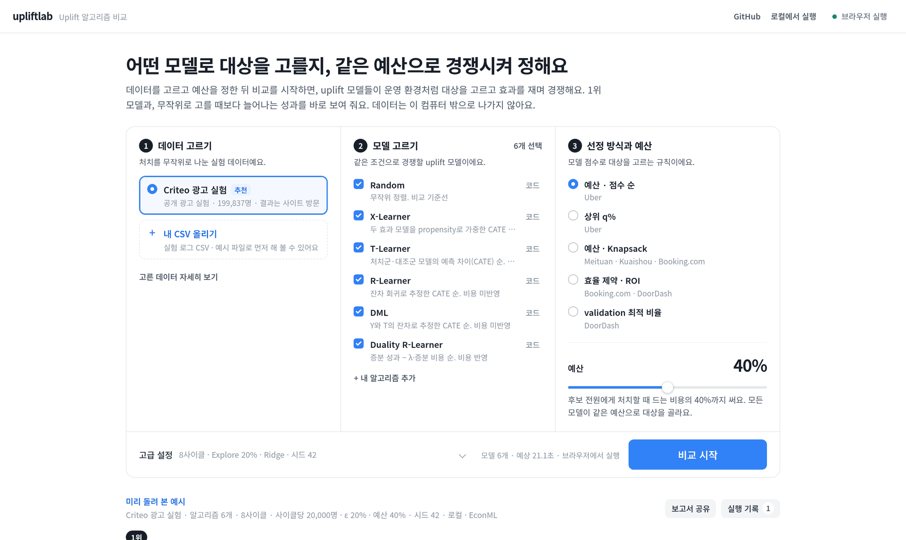

<div align="center">

# upliftlab

**같은 예산으로 증분 성과를 가장 많이 내는 uplift 모델을, 내 실험 데이터로 미리 찾아요.**

[바로 써 보기](https://uplift-lab.vercel.app) · [로컬에서 실행](#시작하기) · [내 알고리즘 추가](#내-알고리즘-추가) · [사용 안내](docs/guide.md)

[](LICENSE)
[](pyproject.toml)
[](https://uplift-lab.vercel.app)

<a href="https://uplift-lab.vercel.app"></a>

</div>

쿠폰 줄 대상을 uplift 모델로 고를 때, Qini가 가장 높은 모델이 운영에서도 가장 많이 남길까요? upliftlab은 모델마다 **대상을 고르고, 처치군과 대조군으로 효과를 재고, 재학습하는** 운영 루프를 사이클마다 반복해요. 그리고 같은 예산에서 실제로 늘어난 성과로 순위를 매겨요. 기본 알고리즘은 [EconML](https://github.com/py-why/EconML)(PyWhy)로 구현했고, 첫 화면은 [Criteo](https://ailab.criteo.com/criteo-uplift-prediction-dataset/) 공개 광고 실험으로 돌린 결과예요.

## 시작하기

**웹**에서는 설치가 필요 없어요. [uplift-lab.vercel.app](https://uplift-lab.vercel.app)을 열면 Criteo 데이터, 기본 모델 6개, 예산 40%가 골라져 있어서 `비교 시작`만 누르면 돼요. 데이터는 브라우저 밖으로 나가지 않아요. 브라우저에는 EconML이 없어서, 웹에서는 같은 방법을 scikit-learn으로 쓴 경량판이 돌아가요.

**로컬**에서는 같은 화면이 내 Python에서 EconML로 돌아가요. 큰 데이터, 이미 설치한 라이브러리, GPU를 그대로 써요.

```bash
pip install git+https://github.com/Funbucket/upliftlab
upliftlab
```

브라우저에 `http://127.0.0.1:4180`이 열려요. uv를 쓴다면 `uvx --from git+https://github.com/Funbucket/upliftlab upliftlab` 한 줄이면 돼요.

## 데이터에서 보고서까지

1. **데이터를 넣어요.** `① 데이터 고르기`에서 `내 CSV 올리기`를 누르고 실험 로그 CSV를 끌어다 놓으면 처치, 결과, 비용, 공변량 열을 알아서 골라 줘요. 확인하고 `데이터셋 추가`를 눌러요.
2. **바로 실행해요.** 데이터 검사를 통과하면 `이 데이터로 바로 실행`을 눌러요. 기본 알고리즘 6개를 같은 예산으로 비교해요.
3. **팀에 보내요.** `보고서 공유`에서 HTML 보고서, PDF, 메신저용 요약을 골라요. 보고서에는 집계 값만 들어가요.

결론에는 1위 모델, Random 대비 증분 성과, 2위와의 차이와 95% CI, 1위 모델이 고른 사용자의 특징이 나와요. 모든 모델이 같은 사용자와 같은 무작위 Explore 그룹을 쓰기 때문에, 차이는 대상을 고른 방식에서만 생겨요.

## 기본 알고리즘과 데이터

| 알고리즘 | 로컬 (EconML) | 하는 일 |
|---|---|---|
| T-Learner | `metalearners.TLearner` | 처치군과 대조군 모델의 예측 차이 |
| X-Learner | `metalearners.XLearner` | 대체한 효과를 propensity로 가중 |
| R-Learner | `dml.NonParamDML` | 잔차로 푸는 비모수 CATE |
| DML | `dml.LinearDML` | 잔차로 푸는 선형 CATE |
| Duality R-Learner | `dml.NonParamDML` 두 개 | 성과와 비용의 CATE를 함께 보고 λ를 validation에서 골라요 |
| Random | NumPy | 비교 기준선 |

결과 화면과 보고서에 EconML과 경량판 중 무엇으로 돌렸는지 표시해요. 각 파일은 `class Model` 하나라서 열어 보고 그대로 고쳐 쓸 수 있어요.

기본 데이터는 [Criteo](https://ailab.criteo.com/criteo-uplift-prediction-dataset/) 광고 실험이에요. 원본 1,398만 명에서 처치군과 대조군을 10만 명씩 뽑은 표본(199,837명, 결과는 사이트 방문)이 사이트와 패키지에 들어 있어요. 내 실험 로그는 `내 CSV 올리기`로 넣어요.

## 내 데이터

처치를 **무작위로 배정한** 실험 로그면 돼요. 1,000행 이상이어야 하고, 열 이름은 자유예요.

| 역할 | 예시 열 | 값 |
|---|---|---|
| 처치 | `treatment` | 0 = 대조군, 1 = 처치. 여러 종류면 1, 2, 3… |
| 결과 | `retained` | 전환, 구매, 리텐션처럼 늘리고 싶은 값 |
| 비용 (선택) | `coupon_cost` | 처치로 쓴 비용. 없으면 처치 1건당 1로 계산해요 |
| 공변량 | `visit_freq`, … | 처치 **전에** 측정한 사용자 특성 |

형식이 헷갈리면 화면의 `예시 파일 내려받기`로 받은 파일을 참고하세요.

## 내 알고리즘 추가

`class Model` 하나를 담은 Python 파일이에요. upliftlab을 import하지 않고, scikit-learn, LightGBM, PyTorch를 평소처럼 써요.

```python
class Model:
    def fit(self, train, validation, context):  # train.X, train.t, train.y, train.cost
        ...
    def predict(self, X):                        # 사용자마다 점수 하나. 점수가 높은 순서로 대상을 골라요
        ...
```

웹에서는 `알고리즘 추가`에서 시작 틀을 골라 편집해요. 로컬에서는 화면 없이도 비교할 수 있어요.

```bash
upliftlab run --data my_experiment.csv --algorithm my_model.py
```

## 더 보기

- [사용 안내](docs/guide.md): 선정 방식 5가지, 명령줄 옵션, 결과 읽는 법
- [알고리즘 계약](engine/README.md): `fit`과 `predict`에 들어오는 값, 코드 검사 규칙
- [개발 참여](CONTRIBUTING.md): 빌드, 테스트, 폴더 구조
- [변경 기록](CHANGELOG.md)

## 라이선스

[MIT](LICENSE). 함께 배포하는 Criteo 표본은 [CC BY-NC-SA 4.0](web/data/LICENSE-criteo.md)이라 비상업적으로만 쓸 수 있어요. Noto Sans KR 글꼴은 SIL Open Font License(`web/fonts/LICENSE`), 편집기 번들은 `web/vendor/LICENSES.txt`를 따라요.
